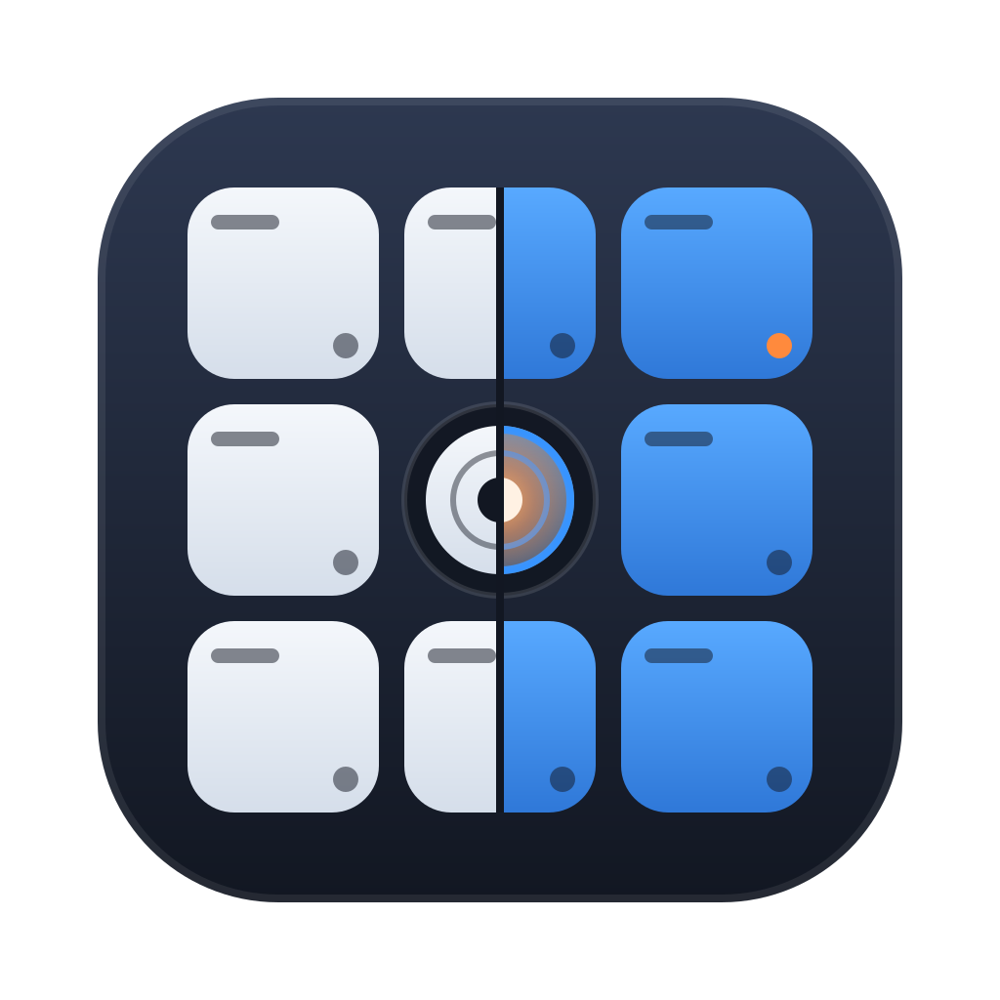
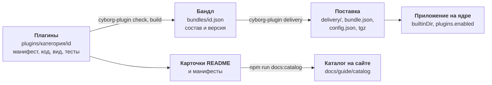

<p align="center">
  
</p>

<h1 align="center">Cyborg Plugins</h1>

<p align="center">
  <b>Плагины для приложений на ядре Cyborg Harness</b>
  <br />
  Каталог по назначению, бандлы для установки пачкой, правила и инструменты для тех, кто пишет свои.
  <br />
  Ядро ничего не знает о предметной области, а всё предметное лежит здесь.
  <br />
  <br />
  <a href="https://github.com/dex-it/cyborg-plugins/actions/workflows/ci.yml"></a>
  
  
  
  <br />
  <br />
  <a href="#зачем">Зачем</a>
  ·
  <a href="#каталог">Каталог</a>
  ·
  <a href="#бандлы">Бандлы</a>
  ·
  <a href="#быстрый-старт">Быстрый старт</a>
  ·
  <a href="#плагин-за-пять-минут">Свой плагин</a>
  ·
  <a href="https://dex-it.github.io/cyborg-plugins/">Документация</a>
  ·
  <a href="#разработка">Разработка</a>
</p>

## Зачем

[Cyborg Harness](https://github.com/dex-it/cyborg-harness) - микроядро: загружает плагины, строит граф контрактов, изолирует сбои и выдаёт права. Предметной области в нём нет ни строчки: ни агента, ни файлов, ни проектов, ни трекеров.

Этот репозиторий - всё остальное. Приложение собирается из ядра и набора плагинов, поэтому каким оно будет, решает набор.

<table align="center">
  <tr>
    <td align="center" width="260"><br><b>Cyborg Harness</b><br>ядро: один глаз, плагины по краям</td>
    <td align="center" width="40">+</td>
    <td align="center" width="260"><br><b>Cyborg Plugins</b><br>плагины: модули вокруг маленького ядра</td>
  </tr>
</table>

- **Каталог по назначению**: агенты, сессии, код, трекеры, расширения агента, рабочее место. Плагин лежит в `plugins/<категория>/<id>/`, идентификатор один на весь репозиторий.
- **Бандлы**: именованный набор плагинов ставится пачкой. Сборка проверяет полноту: у каждого `requires` должен быть поставщик в самом бандле.
- **Открыто для своих**: правила одни для всех, плагин сообщества попадает в каталог pull request'ом.
- **Первый тест схемы**: функции приложения [ai-cyborg](https://github.com/dex-it/ai-cyborg) переезжают сюда плагинами. Если из ядра и этих плагинов собирается такое же приложение, схема работает.

> [!NOTE]
> Репозиторий не фреймворк и не менеджер пакетов. Он хранит плагины, проверяет их общими правилами и собирает из них поставки для приложений на ядре.

## Каталог

Страницы по каждому плагину строятся из карточек в README плагинов: [каталог на сайте](https://dex-it.github.io/cyborg-plugins/catalog/). Сейчас готовые плагины заводятся, а перенос ai-cyborg идёт по [карте](docs/guide/development/roadmap.md).

| Категория | Что в ней | Запланировано |
|---|---|---|
| [`agents`](plugins/) | Движки агентов: чем запускается сессия, как читается её история | `agent-claude-code`, `agent-shell` |
| [`sessions`](plugins/) | Вкладки, терминал, делегирование, изоляция, уведомления | `sessions`, `remote-sessions`, `session-isolation`, `session-notifications`, `next-actions` |
| [`code`](plugins/) | Проекты, дерево файлов, просмотр, git, поиск | `projects`, `files`, `viewer`, `git`, `search` |
| [`trackers`](plugins/) | Задачи, MR и статус из GitHub, GitLab, Jira | `trackers`, `trackers-http` |
| [`extensions`](plugins/) | Магазины плагинов Claude Code, скиллы, серверы MCP | `claude-extensions` |
| [`workbench`](plugins/) | Кнопки-команды, замок окна | `command-buttons`, `pin-lock` |

Список категорий и запланированных плагинов - `plugins/categories.json`: из него строится и эта таблица на сайте.

## Бандлы

Бандл - файл `bundles/<id>.json` со списком плагинов. Из него собирается поставка для приложения и фрагмент настроек `plugins.enabled`:

```json
{
  "format": 1,
  "id": "code-workspace",
  "version": "1.0.0",
  "title": "Работа с кодом",
  "description": "Проекты, дерево файлов, просмотр, git и поиск рядом с сессией.",
  "plugins": ["projects", "files", "viewer", "git", "search"]
}
```

```bash
npm run bundle -- code-workspace --pack
```

Получится `dist/bundles/code-workspace/` с `delivery/` (результат `cyborg-plugin delivery`, его указывают как `builtinDir`), `bundle.json` (состав и версии) и `config.json` (`plugins.enabled`), а рядом архив `code-workspace-1.0.0.tgz`.

Бандлы расширяют друг друга (`extends`), поэтому прикладные наборы строятся на базовых. Запланированы `agent-sessions`, `code-workspace`, `task-trackers` и `ai-cyborg` (всё вместе). Формат и правила - [«Бандлы»](docs/guide/bundles/index.md).

## Быстрый старт

Нужны:

- macOS или Linux (на Windows не проверялось);
- Node.js 24 и npm;
- клон [cyborg-harness](https://github.com/dex-it/cyborg-harness) рядом: пакеты ядра ещё не в реестре.

```bash
git clone https://github.com/dex-it/cyborg-harness.git
(cd cyborg-harness && npm ci --ignore-scripts && npm run build:packages)

git clone https://github.com/dex-it/cyborg-plugins.git
cd cyborg-plugins
npm install
npm run harness:link     # ссылки на ../cyborg-harness в node_modules
npm run check            # раскладка, карточки, бандлы
npm test                 # тесты скриптов и плагинов
```

> [!NOTE]
> Пакеты `@cyborg-harness/*` и команда `cyborg-plugin` публикуются [задачей P-10 ядра](https://github.com/dex-it/cyborg-harness/issues/11). До выпуска ядро берётся из клона (`harness:link`), после - из npm, остальное не изменится.

## Плагин за пять минут

```bash
npm run new -- code my-plugin "Мой плагин"
npm run check && npm run check:plugins && npm run typecheck && npm test
npm run docs:catalog
```

`npm run new` копирует шаблон в `plugins/code/my-plugin/`: манифест, главная часть, контракт, вид, тест на тест-ките ядра и карточка `README.md`. Он сразу проходит все проверки, поэтому от него удобно отталкиваться. Дальше - pull request в `master`; подробно в [руководстве автору](docs/guide/authors/index.md).

Карточка плагина - шапка его `README.md`:

```markdown
---
title: Дерево файлов
summary: Дерево файлов сессии с отметками git
status: beta
tags: [файлы, git]
needs: [git]
---
```

Манифест ядра не принимает чужих полей, поэтому всё, что нужно людям и каталогу, живёт в карточке, а категория определяется путём.

## Как это устроено



Плагины - обычные плагины ядра: каждому свой `manifest.json`, они говорят друг с другом только контрактами. Репозиторий добавляет к ним место в каталоге, карточку, проверку полноты бандлов и сборку поставки. Сборка и проверки используют `cyborg-plugin` из ядра, поэтому плагин здесь собирается тем же способом, что и у любого автора вне репозитория.

## Границы

- **Не заменяет ядро**: манифест, права, контракты, версии и загрузка - забота Cyborg Harness. Здесь только плагины и их сборка в наборы.
- **Не подписывает поставки**: подпись и повторное согласие человека - второй этап изоляции ядра. Контрольные суммы `delivery.json` ядро сверяет при старте.
- **Не ставит плагины в приложение**: репозиторий отдаёт поставку и фрагмент `plugins.enabled`. «Включить бандл» в окне приложения - предложение ядру ([что нужно от ядра](docs/guide/development/harness.md)).
- **Плагины с контрактами `cyborg.*` бывают только встроенными**: сторонний плагин такие контракты отдавать не может, это правило ядра ([пространства имён](docs/guide/authors/namespaces.md)).

## Статус

Ранняя версия: заведён каркас репозитория (раскладка, проверки, сборка бандлов, шаблон, сайт), проверенный на пробном плагине из шаблона. Плагины ai-cyborg переносятся по [карте](docs/guide/development/roadmap.md), задачи - [эпик #5](https://github.com/dex-it/cyborg-plugins/issues/5); пока в каталоге они значатся запланированными. Проверено на macOS (Apple Silicon) и Linux; каждый PR проходит CI на обеих системах. Лицензия не выбрана.

## Документация

Сайт: <https://dex-it.github.io/cyborg-plugins/> - быстрый старт, каталог, бандлы, руководство автору, разработка. Страницы лежат в [`docs/guide/`](docs/guide/index.mdx), сайт собирается из них (`site/`); страницы каталога генерируются.

## Разработка

```bash
npm run check              # раскладка, карточки, бандлы и их полнота
npm run check:plugins      # cyborg-plugin check для каждого плагина
npm run build              # cyborg-plugin build для каждого плагина (dist/plugins)
npm run typecheck          # типы скриптов и плагинов
npm test                   # тесты скриптов и плагинов
npm run bundle -- --all    # собрать все бандлы (dist/bundles)
npm run new -- <категория> <id>   # новый плагин из шаблона
npm run docs:catalog       # страницы каталога для сайта
npm run sync-labels        # метки GitHub по .github/labels.json
```

Код: `plugins/` - плагины по категориям, `bundles/` - бандлы, `templates/plugin/` - шаблон, `scripts/` - проверки и сборка (TypeScript на Node 24 без сборки), `docs/guide/` - страницы сайта, `site/` - сборка сайта (Astro и Starlight).

Каждый PR и пуш в `master` проверяет GitHub Actions на macOS и Linux ([`ci.yml`](.github/workflows/ci.yml)): сборка ядра, проверки, типы, тесты, сверка страниц каталога и сборка бандлов. Сайт собирается и публикуется отдельным workflow ([`docs-site.yml`](.github/workflows/docs-site.yml)), бандлы выходят релизом по тегу `v<версия>` ([`release.yml`](.github/workflows/release.yml)). Задачи, ключи и метки ведутся как в ядре: [«Задачи, метки и ключи»](docs/guide/development/labels.md), правила для ИИ-агентов - в [`CLAUDE.md`](CLAUDE.md).
