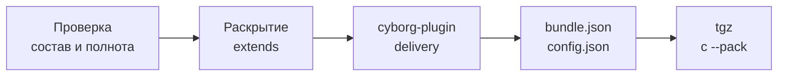

```bash
npm run bundle -- <id>...                  # один или несколько бандлов
npm run bundle -- --all                    # все бандлы из bundles/
npm run bundle -- <id> --out <каталог>     # не в dist/bundles
npm run bundle -- <id> --pack              # плюс архив <id>-<версия>.tgz
```

## Шаги



1. **Проверка.** Замечания самого бандла (плагина нет, нет поставщика `requires`, цикл `extends`) останавливают сборку. Замечания чужих бандлов ей не мешают.
2. **Раскрытие `extends`.** Получается итоговый список плагинов без повторов.
3. **Поставка.** `cyborg-plugin delivery` собирает каждый плагин как `build` и кладёт в `delivery/<id>/`, рядом пишет `delivery.json` с sha256 файлов. Правила сборки плагина - те же, что у `build`: npm-зависимости уходят в бандл, `node:*` и `electron` запрещены.
4. **Описание.** `bundle.json` и `config.json` ([формат](/bundles/format/)).
5. **Архив** (с `--pack`): `<id>-<версия>.tgz` со всем каталогом `<id>/`.

## Результат

```text
dist/bundles/
  code-workspace/
    bundle.json
    config.json
    delivery/
      delivery.json
      projects/ ...
      files/ ...
  code-workspace-1.0.0.tgz        с --pack
```

Каталог `dist/` в git не входит. Сборка стирает только каталог `<out>/<id>`, который создала сама (в нём есть `bundle.json`); если там чужое содержимое, она отказывает и ничего не трогает.

Архив собирается системным `tar` и побайтово воспроизводимым не обещан: состав и контрольные суммы файлов внутри (`delivery.json`) от этого не зависят.

## Релиз

Бандлы выходят вместе с репозиторием по тегу `v<версия>`: workflow `release.yml` собирает все бандлы с `--pack` и прикладывает архивы к релизу GitHub. Версия в теге - версия репозитория (`package.json`); версии бандлов независимы и записаны в их файлах.

:::note[Подписи пока нет]
Архивы и поставка не подписаны: подпись и повторное согласие человека - второй этап изоляции ядра. Контрольные суммы `delivery.json` ядро сверяет при старте, но расхождение пока только сообщение.
:::

## Если сборка не идёт

| Сообщение | Причина |
|---|---|
| `cyborg-plugin не найден` | Не выполнен `npm run harness:link` или клон ядра не собран |
| `плагина ... нет в каталоге` | В бандле опечатка или плагин ещё не добавлен |
| `поставщика в бандле нет` | Нужен плагин с контрактом: добавьте его или расширьте бандл, где он есть |
| `каталог занят чужим содержимым` | `--out` указывает на каталог, который сборка не создавала |
| `cyborg-plugin delivery завершился с кодом 1` | Нарушение в одном из плагинов: его текст выше в выводе |
