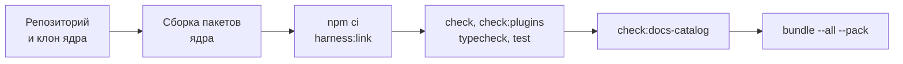

Три workflow в `.github/workflows/`. Действия закреплены по SHA, права токена - `contents: read`, если не нужно больше.

| Workflow | Когда | Что |
|---|---|---|
| `ci.yml` | pull request, push в `master` | Сборка ядра, проверки, типы, тесты, сверка страниц каталога, сборка всех бандлов; macOS и Linux |
| `docs-site.yml` | pull request по путям сайта, push в `master` | Сборка сайта и проверка ссылок; на `master` ещё публикация в GitHub Pages |
| `release.yml` | тег `v*` | Сборка всех бандлов с архивами, релиз GitHub с приложенными `.tgz` |

## ci.yml

Пока пакеты ядра не опубликованы, CI забирает [cyborg-harness](https://github.com/dex-it/cyborg-harness) в `.harness/` на ссылке из переменной репозитория `HARNESS_REF` (по умолчанию `master`), ставит его зависимости без скриптов и собирает пакеты (`npm run build:packages`). Затем `npm run harness:link .harness` кладёт ссылки в `node_modules`. После выпуска пакетов эти шаги заменит обычный `npm ci`.

Проверки идут на `macos-latest` и `ubuntu-24.04`: плагины работают с терминалами и путями, различия систем нужно видеть сразу.

## docs-site.yml

Повторяет workflow сайта ядра: сборка и проверка ссылок на каждый pull request по изменённым путям, публикация только с `master`. Страницы каталога сверяются отдельным шагом `ci.yml`, а не здесь.

Чтобы публикация заработала, в настройках репозитория один раз выбирается Pages - источник «GitHub Actions»; окружение `github-pages` должно принимать ветку `master`.

:::caution[Не делайте проверку required]
У `pull_request` в `docs-site.yml` фильтр путей: required-проверка, которая не запустилась, вешает pull request в `BLOCKED`. Required делайте `ci.yml`, а не сайт.
:::

## release.yml

Тег `v<версия>`: версия в теге должна совпасть с `version` в `package.json`, коммит тега - входить в `master`. Дальше `npm run bundle -- --all --pack`, и архивы `dist/bundles/*.tgz` прикладываются к релизу GitHub. Версии бандлов независимы и записаны в `bundles/*.json`; релиз репозитория - способ выпустить их вместе.

## Переменные и секреты

| Имя | Где | Зачем |
|---|---|---|
| `HARNESS_REF` | переменная репозитория | Ветка или тег ядра для сборки; по умолчанию `master` |

Секретов не требуется: ядро публичное, а релиз создаётся встроенным `GITHUB_TOKEN`.

## Обновления зависимостей

`dependabot.yml`: раз в неделю npm (корень и `site/`) и действия GitHub Actions, минорные и патч-обновления одной группой, мажорные отдельными pull request.
