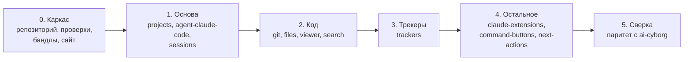

Первая проверка схемы «ядро плюс плагины»: приложение [ai-cyborg](https://github.com/dex-it/ai-cyborg) переезжает сюда плагинами, и из ядра с этими плагинами собирается такое же приложение. Дальше сообщество добавляет свои плагины тем же путём.

:::note[Что готово]
Сделан каркас репозитория: раскладка, проверки, сборка бандлов, шаблон, сайт, метки. Плагинов ai-cyborg пока нет: все строки таблицы ниже «не начато». Таблица живёт в `plugins/categories.json` (поле `planned`) и `bundles/planned.json`, а страницы [каталога](/catalog/) строятся из них. Работа ведётся задачами [эпика «Перенос ai-cyborg» #5](https://github.com/dex-it/cyborg-plugins/issues/5) (40 подзадач по этапам 0-5; [метки и ключи задач](/development/labels/)).
:::

## Откуда переносим

- **Код ai-cyborg** (`src/main`, `src/renderer`): главная часть превращается в главную часть плагина, окно - в вид.
- **Пилоты в ядре** (`playground/plugins`: `sessions`, `agent-claude-code`, `files`, `git`, `viewer`, `trackers` и другие): уже написаны под контракты ядра, но продуктом не считаются. Они - готовый эскиз границ и контрактов, к которому подгоняется перенос.
- **План переезда ядра**: [migration-plan-cyborg.md](https://github.com/dex-it/cyborg-harness/blob/master/docs/06-plans/migration-plan-cyborg.md) (черновик) описывает каналы IPC ai-cyborg, матрицу паритета, запрет менять утверждения существующих тестов и бюджеты. Правила переноса оттуда в силе.

:::caution[План ядра отстал от ai-cyborg]
План ядра составлен на коммите `1f00014` ai-cyborg (2026-11-09). На `6fd308f` (2026-11-16) в приложении уже **76 каналов IPC** (64 `handle` и 12 `on`, было 61), **202 требования в 18 фичах** (было 171 в 16) и **1307 тестов** (было 964). Новое: фича 17 «Удалённые сессии по SSH» (19 требований, `src/main/remote/`, демон `src/agentd/`, голосовой ввод `/voice`) и фича 18 «Запуск файла» (10 требований). Числа в эпике переноса пересняты на `6fd308f`; сверять их нужно скриптом паритета, а не документами.
:::

## Плагины

| Плагин | Категория | Что переносится | Ориентир в ai-cyborg |
|---|---|---|---|
| `projects` | code | Проекты как наборы репозиториев, выбор каталогов | `projects`, `workspaces` |
| `agent-claude-code` | agents | Запуск `claude` с хуками, история сессий, продолжение | `claude-args`, `session-args`, `history`, `events-store` |
| `agent-shell` | agents | Оболочка вместо агента | пилот ядра |
| `sessions` | sessions | Вкладки, терминал, делегирование дочерним сессиям, MCP-сервер сессий (фича 15), плагин Claude Code `parallel-sessions` | `sessions`, `child-sessions`, `session-tools`, `mcp`, `plugin/` |
| `remote-sessions` | sessions | Удалённые сессии по SSH: хосты проекта, агент (демон) на хосте, клоны, обрыв и подхват, MCP-туннель, голосовой ввод | `remote/` (1731 строка), `src/agentd/` (2075), `mic` |
| `session-isolation` | sessions | Worktree для параллельных сессий в одном репозитории | фича 09 «Изоляция» |
| `session-notifications` | sessions | Уведомление, когда сессия ждёт | `notify-args` |
| `next-actions` | sessions | Кнопки следующих шагов от модели через MCP | `suggestions` |
| `files` | code | Дерево файлов сессии, отметки git | `files`, `allowed-paths` |
| `viewer` | code | Просмотр, сравнение с HEAD, запуск файла в системном терминале (фича 18), правка Markdown (фича 16) | `run-file`, `run-approvals`, `run-terminal`, `md-viewer`, Monaco |
| `git` | code | Ветка, статус, смена ветки, содержимое HEAD | `git`, `branch-name` |
| `search` | code | Поиск файла, строки, среди изменений | `search-run`, `search-args`, `git-search` |
| `trackers` | trackers | GitHub, GitLab, Jira: задачи, MR, «Статус» | `trackers`, `mrs`, `jira`, `task-details` |
| `trackers-http` | trackers | Трекер через HTTP API | пилот ядра |
| `claude-extensions` | extensions | Магазины плагинов Claude Code, скиллы, MCP | `extensions*`, `hubs` |
| `command-buttons` | workbench | Кнопки-команды, свои фразы | `commands`, `prompts`, `command-store` |
| `pin-lock` | workbench | Замок окна | пилот ядра |

Колонка «Ориентир» - где искать исходник, а не готовое соответствие один к одному: границы плагинов определяет контрактная модель ядра, и часть модулей разойдётся между плагинами.

## Порядок



| Этап | Результат | Бандл |
|---|---|---|
| 0. Каркас | Раскладка, проверки, сборка бандлов, шаблон, сайт | - |
| 1. Основа | Сессия Claude Code в окне ядра: проекты, вкладки, делегирование, SSH, уведомления, изоляция | `agent-sessions` |
| 2. Код | Дерево, просмотр, git и поиск рядом с сессией | `code-workspace` |
| 3. Трекеры | Задачи и MR, карточка «Статус» | `task-trackers` |
| 4. Остальное | Расширения Claude Code, кнопки-команды, подсказки шагов | - |
| 5. Сверка | Бандл `ai-cyborg` повторяет приложение: матрица паритета, бюджеты | `ai-cyborg` |

Порядок задан зависимостями контрактов: `sessions` нуждается в `projects` и агенте, `files` и `git` - в проектах и сессиях, `trackers` - в `git` и проектах. Сборка бандла проверяет это сама.

## Матрица паритета

«Ничего не потеряно» проверяется данными, а не чтением документов. `parity/matrix.json` держит **338 строк** на коммите ai-cyborg `6fd308f`: 202 требования, 78 каналов IPC, 19 событий окну, 13 ключей хранилища (10 и 3 семейства), 8 диалогов и 18 файлов данных. У каждой строки есть плагин-владелец, задача эпика и статус (`не начато`, `перенесено`, `паритет подтверждён`, `допустимое расхождение`; последнему нужна причина и ссылка на решение).

```bash
npm run parity                         # сводка по матрице
npm run parity -- ../ai-cyborg         # сверка с настоящим кодом: новое, исчезнувшее, несовпавший вид
npm run parity -- ../ai-cyborg --write-missing   # добавить новое с владельцем «?», пока не назначен - проверка красная
```

Сводка по владельцам и задачам - на странице [«Паритет с ai-cyborg»](/catalog/parity/). CI клонирует ai-cyborg на якорном коммите и запускает сверку, поэтому правка матрицы вслепую не пройдёт. Когда ai-cyborg уйдёт вперёд, якорь переносят осознанно: новая строка получает владельца, а не теряется.

Числа плана ядра устарели не случайно: за неделю ai-cyborg получил 15 каналов, 3 события и 31 требование. Скрипт находит такое сам.

## Как считать перенос законченным

Плагин переехал, когда выполнены условия плана переезда ядра: все требования корпуса ai-cyborg по его функции подтверждены теми же проверками, прежние тесты зелёные с теми же утверждениями, поведение на записанных сессиях совпадает, бюджеты производительности не нарушены. Статусы ведёт владелец, самому себе «принято» не ставят.

## Что откроется после переноса

- Сторонние плагины на тех же контрактах `cyborg.*`: другой агент рядом с `agent-claude-code`, другой трекер рядом с `trackers`.
- Свои бандлы: например, ai-cyborg без трекеров или только с `agent-sessions`.
- Другие приложения на ядре, которые берут из каталога то, что им нужно.
