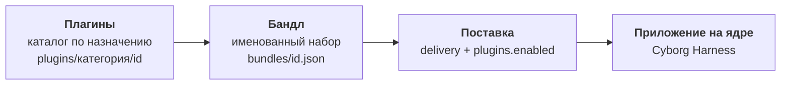

import { Card, CardGrid } from '@astrojs/starlight/components';

## Ядро и плагины

[Cyborg Harness](https://github.com/dex-it/cyborg-harness) - микроядро: оно загружает плагины, строит граф контрактов, изолирует сбои и выдаёт права. Предметной области в нём нет: ни агента, ни файлов, ни проектов, ни трекеров.

Всё предметное приносят плагины, и живут они здесь. Приложение собирается из ядра и списка плагинов: каким будет приложение, решает набор, а не код ядра.

:::note[Статус]
Ранняя версия. Репозиторий заведён вместе с каркасом: раскладка, проверки, сборка бандлов и сайт работают на пробном плагине. Перенос функций приложения [ai-cyborg](https://github.com/dex-it/ai-cyborg) в плагины идёт: что и в каком порядке - в [карте переноса](/development/roadmap/). Пока в [каталоге](/catalog/) плагины запланированы, а не готовы.
:::

## Что здесь есть

<CardGrid>
  <Card title="Каталог по назначению" icon="puzzle">
    Плагины лежат по каталогам: агенты, сессии, код, трекеры, расширения агента, рабочее место. Идентификатор общий на весь репозиторий, категория только помогает искать.
  </Card>
  <Card title="Бандлы" icon="random">
    Именованный набор плагинов ставится пачкой. Сборка проверяет полноту: у каждого `requires` должен найтись поставщик в самом бандле.
  </Card>
  <Card title="Открытый для своих" icon="rocket">
    Правила одни для всех: карточка в README, манифест по правилам ядра, тесты на тест-ките. Своё добавляется pull request'ом.
  </Card>
  <Card title="Первый тест схемы" icon="approve-check">
    Функции приложения ai-cyborg переезжают сюда плагинами. Если из ядра и этих плагинов собирается такое же приложение, схема работает.
  </Card>
</CardGrid>

## Дальше

- [Быстрый старт](/start/) - клонировать, собрать бандл, посмотреть результат.
- [Подключить к приложению](/start/use/) - как поставка попадает в приложение на ядре.
- [Бандлы](/bundles/) - что это и как описываются.
- [Автору плагина](/authors/) - раскладка, карточка, проверки, идентификаторы.
